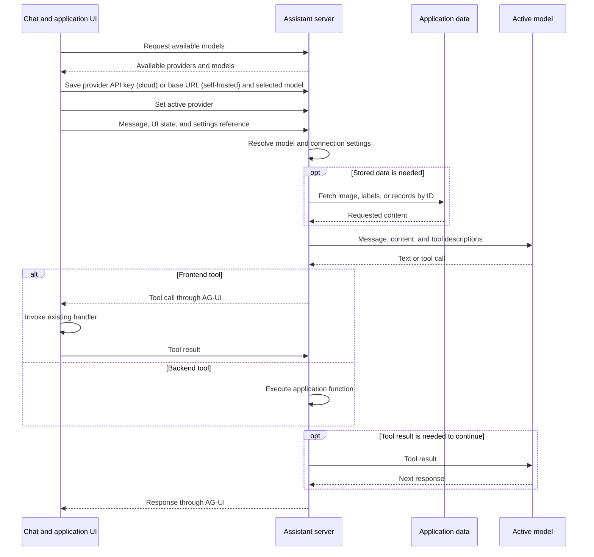
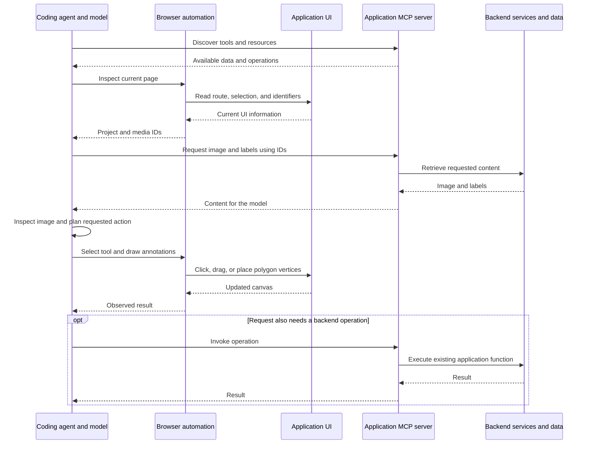
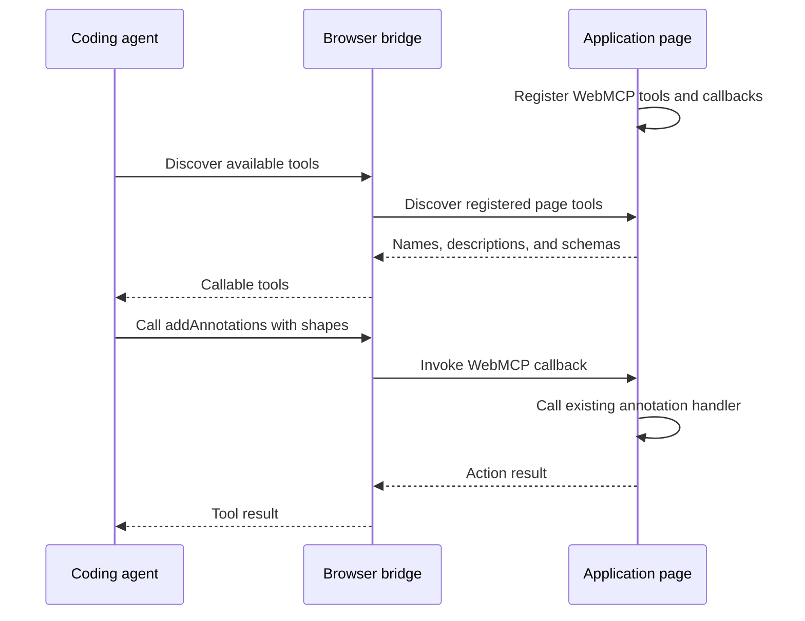

# AI assistant and agent access

**Updated:** 19 October 2026

## Feature overview

Allow users to ask questions and request application actions through either an internal chat or an external coding agent. Requests can include retrieving information, navigating pages, changing application data, and running supported workflows.

Annotation is one example: a user asks to annotate an image or video frame, the model receives the image and available labels, and the application applies the proposed annotations through its existing UI handler.

The design has two parts:

| Part | Approach | Purpose |
| --- | --- | --- |
| 1 | AG-UI: chat, server, tools, and model | Internal chat using the user's API key and selected model |
| 2 | Coding agent with WebMCP and/or an MCP server | External access to application data and actions, optionally enhanced by skills |

## Part 1 — Internal chat through AG-UI

### User experience and responsibilities

The user configures a provider (an API key for a cloud provider, or a base URL for a self-hosted model server), selects a model from the list supplied by the backend, and sends requests through the chat. The chat displays responses and progress and lets the user cancel an active request. Users can ask for any application action; fulfillment depends on the tools exposed to the model.

| Component | Responsibility |
| --- | --- |
| Chat UI | Collect messages, attach relevant UI state, display responses, and handle cancellation |
| Server | Resolve referenced application data, call the configured model, and exchange AG-UI events with the UI |
| Tools | Describe supported actions and connect model requests to existing frontend or backend functions |
| Model | Interpret the request and supplied information, then return text or request a tool call |

AG-UI defines the exchange between the chat UI and server, including streamed text and tool-call information. Model selection, credentials, and tool execution remain responsibilities of the application. [1]

### Provider, model, and assistant settings

Provide a separate settings flow for configuring providers and selecting models. Each provider stores its own connection settings and selected model. Assistant settings store one active provider, or `null` when none is active.

Providers are one of two kinds, which determine the required connection setting:

| Kind | Examples | Required | Not accepted | Model list source |
| --- | --- | --- | --- | --- |
| Cloud | OpenAI, Anthropic | `apiKey` | `baseUrl` (the backend uses the provider's fixed endpoint) | Backend-curated list for that provider |
| Self-hosted | Ollama, LM Studio, llama.cpp server, vLLM, OpenVINO Model Server | `baseUrl` of an OpenAI-compatible endpoint, e.g. `http://localhost:11434/v1` | `apiKey` | Fetched from the server's `GET {baseUrl}/models` |

A cloud provider is configured when its API key is set. A self-hosted provider is configured when its base URL is set and the endpoint responds.

The active model is derived from the active provider's selected model; it is not stored a second time. Switching providers preserves each provider's connection settings and model selection.

| Method | Endpoint | Purpose                                                                                                                                                            |
| --- | --- |--------------------------------------------------------------------------------------------------------------------------------------------------------------------|
| GET | `/api/assistant/providers` | List supported providers with their kind, selected model, and connection status: whether an API key is configured (cloud) or the configured base URL (self-hosted) |
| PATCH | `/api/assistant/providers/<provider>` | Update that provider's selected model and its connection setting (`apiKey` for cloud, `baseUrl` for self-hosted); omitted fields remain unchanged                  |
| GET | `/api/assistant/models?provider=<provider>` | List models available for that provider                                                                                                                            |
| GET | `/api/assistant/settings` | Return the active provider and its resolved model, or `null` values when no provider is active                                                                     |
| PATCH | `/api/assistant/settings` | Set `activeProvider` to a configured provider or `null`                                                                                                            |

For example, OpenAI and Anthropic can each have a saved key and selected model, and Ollama can have a saved base URL and selected model. Setting `activeProvider` to `anthropic` uses Anthropic's saved selection and key. Switching it to `ollama` uses the saved base URL and the model selected from that server.

Keep an in-progress request and its tool continuations on the model selected when it started. Settings changes apply to the next request.

**Open question:** Are the active provider and per-provider model selections global, or scoped to each chat ID? The endpoints above show the global form. If selections are per chat, their routes and payloads need chat scope; provider credentials remain configured separately. There is at most one active model within the chosen scope.

Chat requests identify the applicable configuration so the server can resolve the model and its connection settings. They do not need to repeat the raw API key or base URL.

### Request and tool flow

1. The UI sends the user's message and relevant UI state.
2. The server resolves the active model settings and retrieves any needed stored data.
3. The server sends the message, supporting content, and tool descriptions to the model.
4. The model returns text or requests a tool call.
5. The server executes backend tools; the UI receives frontend tool calls through AG-UI and invokes its existing handlers.
6. Tool results return to the model when needed to continue the request.

A tool defines its name, purpose, and accepted arguments. Application code executes the requested action. Tool descriptions may be configured on the server or advertised by the UI; executable UI callbacks stay in the frontend.

For example, a backend tool such as `getProjectLabels(projectId)` calls an existing application service and returns its result. The model does not query the database directly. A frontend tool such as `addAnnotations(...)` invokes the existing canvas handler.

Cancelling stops generation and further processing where possible.

### UI state and stored data

The server does not need to store or track the current UI state. The UI supplies relevant information with each request.

| Information | Source |
| --- | --- |
| Current route, selected project or media, selected frame, active tool, unsaved changes | Frontend |
| Stored images, project labels, saved annotations, other records | Existing backend services |

For “Annotate the dog and person in this image,” the UI sends the message with the selected image/frame identifier and available labels. It can also supply the image content directly. When given an identifier, the server retrieves the image and provides it to the model.

The model returns a structured annotation tool call with labels and shapes. The server forwards the call through AG-UI, and the UI invokes its existing annotation handler. For “What do you see in this image?”, the response may simply be text.

### Conversation retention

**Open question:** Should messages and tool results remain ephemeral, be retained in server memory, or be persisted in a database?

Define whether conversations survive page reloads, server restarts, or later visits.

### Implementation entry points

Build the backend model list, model settings, the chat panel, sending and cancellation, server model handling, and AG-UI response handling. Connect tool calls to existing application functions and add data lookups where needed.

## Part 2 — Coding agent with WebMCP and/or an MCP server

### Responsibilities

The coding agent uses its own model and credentials to interpret the user's request and coordinate actions. The proposed integration gives it two connections: an application MCP server for stored data and backend operations, and a browser connection for the live UI. WebMCP is an optional way to invoke exposed frontend actions through that browser connection.

| Component | Responsibility |
| --- | --- |
| Coding agent | Discover available capabilities, request information, process results with its model, and choose actions |
| Application MCP server | Expose tools and resources for application data and supported backend operations |
| Browser automation | Inspect the current UI, navigate, click, type, drag, and draw through existing controls |
| WebMCP tools, optional | Expose named frontend actions whose callbacks run in the page |
| WebMCP bridge | Expose page WebMCP tools to an external agent when this option is used |
| Skills, optional | Explain application concepts, workflows, and how to use the available capabilities |

The application MCP server is part of this design. Its tool and resource descriptions tell the agent what information is available and how to request it. Calls then return the relevant records, labels, images, or other content through existing backend services. Connecting to MCP does not automatically give the model all database contents or knowledge of the current page. [3]

The browser connection and application MCP server serve different purposes. A browser automation MCP server, such as Playwright MCP, controls the browser; our application MCP server exposes application data and operations. Browser automation can also be provided through a CLI. [4][6]

### Application data and live UI state

The agent obtains current UI information from the open page. For example, browser automation can read project and media IDs from the URL or explicit DOM metadata such as `data-project-id` and `data-media-id`.

The agent passes those IDs to application MCP tools to retrieve stored images, labels, or records. The server receives explicit identifiers; it does not infer which page the user is viewing.

Current UI state exists only while the application retains it. Closing the browser loses state held only in frontend memory. Reopening the application does not restore that state. Data saved in the backend remains available and can be loaded again; this design adds no UI-state restoration mechanism.

For visual tasks, the agent's tooling supplies the retrieved image as image input to its model. The backend uses the media ID to locate the image.

### Browser automation with application MCP

The agent coordinates the two connections. The application MCP server retrieves data or runs backend operations. Browser automation performs actions in the UI. **This flow does not require WebMCP.** Clicks, typing, and drawing trigger the application's existing handlers, which update UI state.

The diagram uses annotation as an example. The agent can also navigate, change selections, fill forms, use processing controls, or perform other browser interactions requested by the user. The application's existing handlers retain their normal role, including saving data when the workflow calls for it.

### Drawing annotations through browser interactions

The agent can select a label, activate a drawing tool, click polygon vertices, drag a bounding box, and finish an annotation. It can also activate the existing segmentation tool, supply a point or box through browser interactions, and accept or refine the result.

These actions update UI state through the application's existing handlers. No WebMCP tool or callback is needed for this workflow. The same approach applies to other UI operations requested by the user.

When drawing from image coordinates, the agent must map them to the displayed canvas, including zoom and pan.

### Optional WebMCP actions and browser bridge

**WebMCP is still under development.** Its specification is a draft Community Group Report, not a W3C Standard. The API and browser support may change. [2]

WebMCP lets the page register named tools with descriptions, input schemas, and execution callbacks. An action such as `addAnnotations` can call the existing frontend handler with all polygon vertices at once. The page must deliberately expose that action; private frontend functions do not become callable automatically. [2]

**An external coding agent needs a compatible browser integration to discover and invoke these page tools.** For an agent connected through MCP, this means a bridge that exposes WebMCP tools over MCP. Registering tools in the page alone does not make them reachable from the coding agent.

Playwright MCP is one available bridge: its documented WebMCP support exposes page-registered tools in the agent's MCP tool list and updates that list as the active page changes. A separate custom WebMCP middleware service is therefore not required when this integration is used. Browser and bridge versions must support the relevant WebMCP API. [4][7]

A browser-native agent with WebMCP support can use its built-in integration. This does not make a separate bridge mandatory for every WebMCP consumer. [2][8]

A page tool is available while its owning page is loaded and registered. The agent can navigate with browser automation, discover the tools on the new page, and continue. WebMCP and browser interactions can be used in the same task.

### Optional skills

Skills can explain application terminology, where to find identifiers, which MCP tools retrieve data, and how to complete browser workflows. They may include supporting scripts. They enhance the agent's use of the connections above; they do not supply live data or create browser access by themselves. [5]

### Implementation entry points

Expose application data and backend operations through MCP, make relevant UI identifiers readable, and provide browser automation for UI actions. If direct frontend tool calls are needed, add WebMCP callbacks and a compatible bridge. Add skills where application-specific guidance helps the agent complete tasks.

## Open questions

- Are the active provider and per-provider model selections global or scoped to a chat ID?
- Are conversations ephemeral, retained in memory, or persisted in a database? What survives reloads and restarts?
- Should we implement the action-specific assistants or a single assistant for all actions (e.g. if user starts chat about annotations with opened annotator and then closed annotator, UI won't be able to proceed with the generated response)?
- Should we support self-hosted models or only cloud providers?

## References

The flows are application design proposals. These sources describe the underlying protocols and connection capabilities.

1. [AG-UI overview](https://docs.ag-ui.com/introduction) and [tool exchange](https://docs.ag-ui.com/concepts/tools).
2. [WebMCP specification](https://webmachinelearning.github.io/webmcp/).
3. [MCP server concepts](https://modelcontextprotocol.io/docs/learn/server-concepts).
4. [Browser automation through MCP](https://github.com/microsoft/playwright-mcp).
5. [Agent Skills overview](https://agentskills.io/home).
6. [Browser automation through CLI and skills](https://github.com/microsoft/playwright-cli).
7. [Playwright MCP release notes: page WebMCP tool exposure](https://github.com/microsoft/playwright-mcp/releases/tag/v0.0.82).
8. [WebMCP and AI agents](https://developer.chrome.com/docs/ai/agents).
